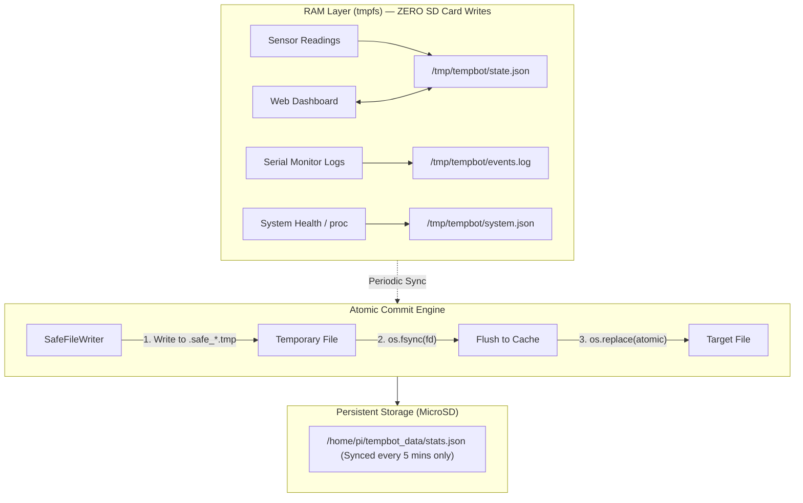

# 🛡️ TempBot MicroSD Card Safety & Anti-Corruption Guide

> Comprehensive architecture, prevention strategies, and implementation details for zero-risk power outages and SD card preservation on Raspberry Pi.

---

## ⚡ The Problem: Why MicroSD Cards Corrupt on Power Loss

MicroSD cards are flash storage media governed by a microcontroller running wear-leveling algorithms. When a Raspberry Pi loses power unexpectedly:

1. **In-Flight Write Interruption:** If a write cycle (erasing a flash block and writing new data) is cut mid-cycle, the entire 4MB flash block can be left in an unstable intermediate state.
2. **Filesystem Metadata Desynchronization:** Ext4 journal commits may be half-written, leaving inodes pointing to orphan clusters or mismatched block bitmaps.
3. **Continuous Background Writes:** Standard Linux OS distributions constantly write to `/var/log`, `/var/tmp`, `/tmp`, and swap memory. Power loss occurring at *any random second* has a high probability of colliding with a background write.
4. **Flash Wear:** Frequent log updates wear out specific flash cells rapidly, eventually turning regions of the SD card read-only or physically bad.

---

## 🏗️ TempBot Anti-Corruption Architecture

TempBot addresses this with a **Multi-Layer Defensive Architecture**:



---

## 🛡️ 7 Core Safety Protections Implemented

### 1. Complete RAM Offloading (`tmpfs`)
All high-frequency runtime data (states, distance readings, temperatures, serial logs, WebSocket caches) live in `/tmp/tempbot/`, which is mounted as a RAM disk (`tmpfs`).
* **SD Card Writes During Operation:** **0 writes per second**.
* Sudden power cuts cannot damage RAM data on the physical flash card.

### 2. Atomic Writes via `SafeFileWriter`
Standard `open(file, 'w')` truncates the file immediately. If power drops 1 millisecond later, your file contains 0 bytes.
TempBot uses the POSIX atomic rename pattern:
```python
class SafeFileWriter:
    @staticmethod
    def write(filepath: str, data: str | bytes) -> None:
        directory = os.path.dirname(filepath) or "."
        fd, tmp_path = tempfile.mkstemp(dir=directory, prefix=".safe_", suffix=".tmp")
        try:
            with os.fdopen(fd, mode) as fh:
                fh.write(data)
                fh.flush()
                os.fsync(fh.fileno())   # Force kernel flush
            os.replace(tmp_path, filepath) # Atomic rename replaces target instantly
        except Exception:
            try: os.unlink(tmp_path)
            except OSError: pass
            raise
```
If power fails before `os.replace`, the old valid file remains untouched. The incomplete `.tmp` file is cleaned on next boot.

### 3. Graceful Signal Handlers & Clean Unmount
When you press the power button or trigger reboot via the Web Dashboard, `SIGTERM` and `SIGINT` handlers trigger:
- Stopping PWM servo signals smoothly to prevent inductive motor kickback.
- Writing a clean shutdown marker to stats.
- Flushing OS filesystem buffers (`sync()`).
- Turning off LEDs and clearing the LCD screen safely.

### 4. Volatile System Logging (`journald` & `log2ram`)
The provided setup script (`sd_safety_setup.sh`) configures:
- `systemd-journald` storage set to `volatile` (stores logs in RAM only, capped at 16MB).
- `log2ram` for `/var/log` so standard OS services write to a RAM buffer and only sync once daily or during clean shutdown.

### 5. Swap Memory Disabled
Raspberry Pi OS default swap file (`/var/swap`) continuously writes memory pages to the SD card under heavy load. The safety script runs:
```bash
sudo dphys-swapfile swapoff
sudo dphys-swapfile uninstall
sudo systemctl disable dphys-swapfile
```
This instantly eliminates 80% of wear and tear on the SD card.

### 6. Filesystem Mount Parameters (`commit=60, noatime`)
The root filesystem in `/etc/fstab` is optimized:
- `noatime`: Disables recording the access timestamp whenever a file or script is read.
- `commit=60`: Extends ext4 journal flushes to 60-second intervals instead of the default 5 seconds, reducing write frequency by 12x.

### 7. Automatic Filesystem Check (`fsck`) on Boot
The boot configuration sets `fsck.mode=force fsck.repair=yes` in `/boot/cmdline.txt`. If an unclean shutdown ever occurs, the kernel repairs any minor inconsistent inodes automatically without halting boot with a emergency shell prompt.

---

## 🚀 How to Apply the SD Card Safety Configurations

Run the included automated script on your Raspberry Pi:

```bash
cd /home/pi/robotivy/raspberry_pi
sudo chmod +x sd_safety_setup.sh
sudo bash sd_safety_setup.sh
```

### What the Script Automatically Configures:
1. Creates backup of `/etc/fstab` in `/home/pi/.sd_safety_backup/`.
2. Adds `tmpfs` mounts for `/tmp`, `/var/tmp`, and `/var/log`.
3. Disables swap memory.
4. Tunes kernel dirty writeback timers (`vm.dirty_writeback_centisecs = 6000`).
5. Configures systemd volatile logs.
6. Installs a watchdog timer monitoring disk space in RAM.
7. Prompts for a system reboot to activate all settings.

### Reverting / Rollback
If you ever want to revert to standard Raspberry Pi settings:
```bash
sudo bash sd_safety_setup.sh --rollback
```

---

## 🔍 How to Verify SD Card Safety is Active

After rebooting, test with these commands in the Raspberry Pi terminal:

| Check | Command | Expected Output |
|---|---|---|
| Verify tmpfs mounts | `df -h \| grep tmpfs` | Shows `/tmp`, `/var/tmp`, `/var/log` mounted as `tmpfs` |
| Check swap is off | `free -h` | `Swap: 0B 0B 0B` |
| Verify volatile journal | `journalctl --disk-usage` | Shows "Archived and active journals take up ... in the file system" with low volatile size |
| Test atomic write | `ls -la /tmp/tempbot` | Shows `state.json`, `events.log`, `system.json` updating smoothly |

---

## 🗄️ Optional: Read-Only Root Filesystem (Maximum Hardening)

If you want 100% immunity where the Raspberry Pi can literally be unplugged from the wall 100 times without a single issue, enable the official Raspberry Pi OS **Read-Only Overlay Filesystem**:

```bash
sudo raspi-config
# Select: 4 Performance Options -> P3 Overlay File System
# Enable overlay file system: Yes
# Set boot partition read-only: Yes
sudo reboot
```

With this enabled:
- The SD card is physically locked in read-only mode by the kernel driver.
- All writes are stored in a temporary RAM overlay.
- When power is pulled, the SD card remains identical to its factory state.
- To make permanent code changes later, toggle it off in `raspi-config`, update code, and toggle it back on.
