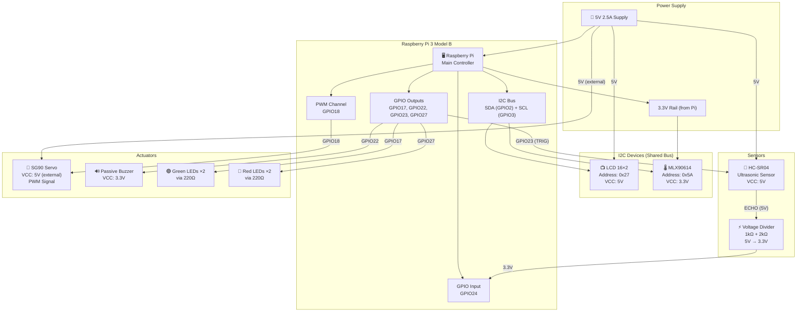
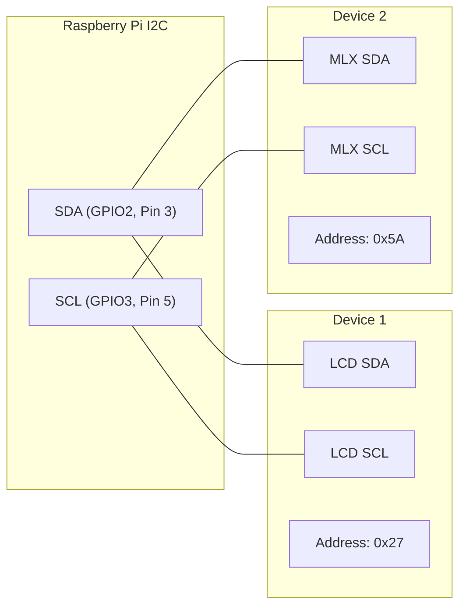

# 🔌 TempBot Wiring Diagram

> Complete wiring guide for connecting all components to the Raspberry Pi 3 Model B.

---

## 📋 Pin Assignment Summary

| Component | Signal | GPIO (BCM) | Physical Pin | Direction | Notes |
|---|---|:---:|:---:|---|---|
| Green LED | Anode | GPIO17 | Pin 11 | Output | Via 220Ω resistor |
| Red LED | Anode | GPIO27 | Pin 13 | Output | Via 220Ω resistor |
| Buzzer | Signal | GPIO22 | Pin 15 | Output | Passive buzzer |
| HC-SR04 | TRIG | GPIO23 | Pin 16 | Output | 3.3V logic OK |
| HC-SR04 | ECHO | GPIO24 | Pin 18 | Input | **Via voltage divider** (5V → 3.3V) |
| SG90 Servo | PWM Signal | GPIO18 | Pin 12 | Output (PWM) | Hardware PWM channel |
| LCD 16×2 | SDA | GPIO2 (SDA1) | Pin 3 | I2C Data | Shared I2C bus |
| LCD 16×2 | SCL | GPIO3 (SCL1) | Pin 5 | I2C Clock | Shared I2C bus |
| MLX90614 | SDA | GPIO2 (SDA1) | Pin 3 | I2C Data | Shared I2C bus |
| MLX90614 | SCL | GPIO3 (SCL1) | Pin 5 | I2C Clock | Shared I2C bus |

---

## 🗺️ Raspberry Pi GPIO Header — Full Pinout with Connections

```
                    Raspberry Pi 3 Model B
                    ┌──────────────────────┐
                    │  ┌─USB─┐   ┌─USB─┐  │
                    │  └─────┘   └─────┘  │
                    │  ┌──Ethernet──────┐  │
                    │  └────────────────┘  │
                    │                      │
    3.3V Power [1]  ●──┐            ┌──●  [2]  5V Power ─────── HC-SR04 VCC
                       │            │                            LCD VCC
  I2C SDA (GPIO2) [3]  ●──┐    ┌──●  [4]  5V Power ─────── SG90 VCC (or ext.)
  ═══════════════       │  │    │  │
  → LCD SDA             │  │    │  │
  → MLX90614 SDA        │  │    │  │
                       │  │    │  │
  I2C SCL (GPIO3) [5]  ●──┐    ┌──●  [6]  GND ─────────── HC-SR04 GND
  ═══════════════       │  │    │  │                        LCD GND
  → LCD SCL             │  │    │  │                        SG90 GND
  → MLX90614 SCL        │  │    │  │                        Buzzer GND
                       │  │    │  │                        LED cathodes
    GPIO4         [7]  ●  │    │  ●  [8]  GPIO14 (TXD)
                       │  │    │  │
              GND [9]  ●  │    │  ●  [10] GPIO15 (RXD)
                       │  │    │  │
  ★ GREEN LED         │  │    │  │
  GPIO17        [11]  ●──┘    └──●  [12] GPIO18 ★ SG90 SERVO (PWM)
  → 220Ω → LED(+)     │            │     → Servo signal wire (orange)
                       │            │
  ★ RED LED           │            │
  GPIO27        [13]  ●──┘         ●  [14] GND
  → 220Ω → LED(+)     │            │
                       │            │
  ★ BUZZER            │            │
  GPIO22        [15]  ●──┘         ●  [16] GPIO23 ★ HC-SR04 TRIG
  → Buzzer (+)         │            │     → TRIG pin directly
                       │            │
    3.3V        [17]  ●             ●  [18] GPIO24 ★ HC-SR04 ECHO
  → MLX90614 VCC       │            │     → Via 1kΩ+2kΩ voltage divider
                       │            │
    GPIO10      [19]  ●             ●  [20] GND
                       │            │
    GPIO9       [21]  ●             ●  [22] GPIO25
                       │            │
    GPIO11      [23]  ●             ●  [24] GPIO8
                       │            │
              GND [25]  ●             ●  [26] GPIO7
                       │            │
    GPIO0       [27]  ●             ●  [28] GPIO1
                       │            │
    GPIO5       [29]  ●             ●  [30] GND
                       │            │
    GPIO6       [31]  ●             ●  [32] GPIO12
                       │            │
    GPIO13      [33]  ●             ●  [34] GND
                       │            │
    GPIO19      [35]  ●             ●  [36] GPIO16
                       │            │
    GPIO26      [37]  ●             ●  [38] GPIO20
                       │            │
              GND [39]  ●             ●  [40] GPIO21
                       │            │
                    └──────────────────────┘

  ★ = TempBot connection       ═══ = I2C bus (shared)
```

---

## 🔗 Component Connection Diagrams

### 1. 🌡️ MLX90614 IR Temperature Sensor (I2C — Address 0x5A)

```
  Raspberry Pi                    MLX90614
  ┌──────────┐                  ┌──────────┐
  │          │                  │          │
  │  Pin 17  │── 3.3V ────────│  VCC     │
  │  (3.3V)  │                  │          │
  │          │                  │          │
  │  Pin 3   │── SDA ─────────│  SDA     │
  │  (GPIO2) │                  │          │
  │          │                  │          │
  │  Pin 5   │── SCL ─────────│  SCL     │
  │  (GPIO3) │                  │          │
  │          │                  │          │
  │  Pin 6   │── GND ─────────│  GND     │
  │  (GND)   │                  │          │
  └──────────┘                  └──────────┘

  ⚠️ MLX90614 operates at 3.3V — do NOT connect to 5V!
```

### 2. 📺 I2C LCD 16×2 Display (I2C — Address 0x27)

```
  Raspberry Pi                    LCD Module (with I2C backpack)
  ┌──────────┐                  ┌──────────────────┐
  │          │                  │                  │
  │  Pin 2   │── 5V ──────────│  VCC             │
  │  (5V)    │                  │                  │
  │          │                  │                  │
  │  Pin 3   │── SDA ─────────│  SDA             │
  │  (GPIO2) │                  │                  │
  │          │                  │                  │
  │  Pin 5   │── SCL ─────────│  SCL             │
  │  (GPIO3) │                  │                  │
  │          │                  │                  │
  │  Pin 6   │── GND ─────────│  GND             │
  │  (GND)   │                  │                  │
  └──────────┘                  └──────────────────┘

  ℹ️ LCD uses 5V power but I2C data lines are 3.3V compatible
     through the PCF8574 I2C backpack.
```

### 3. 📏 HC-SR04 Ultrasonic Sensor (with Voltage Divider)

```
  Raspberry Pi                    HC-SR04
  ┌──────────┐                  ┌──────────┐
  │          │                  │          │
  │  Pin 2   │── 5V ──────────│  VCC     │
  │  (5V)    │                  │          │
  │          │                  │          │
  │  Pin 16  │── TRIG ────────│  TRIG    │
  │ (GPIO23) │                  │          │
  │          │                  │          │
  │  Pin 18  │── ECHO ──┐      │  ECHO ──┤
  │ (GPIO24) │          │      │          │
  │          │          │      │          │
  │  Pin 6   │── GND ─┐ │     │  GND     │
  │  (GND)   │        │ │      └──────────┘
  └──────────┘        │ │
                      │ │
          ┌───────────┘ │
          │             │
          │   Voltage Divider:
          │             │
          │      ECHO pin (5V output)
          │             │
          │          ┌──┴──┐
          │          │ 1kΩ │  R1
          │          └──┬──┘
          │             │
          │             ├──────── → GPIO24 (Pin 18)
          │             │           (receives ~3.3V)
          │          ┌──┴──┐
          │          │ 2kΩ │  R2
          │          └──┬──┘
          │             │
          └─────────────┘
                GND
```

### 4. 🦾 SG90 Servo Motor (PWM)

```
  Raspberry Pi                    SG90 Servo
  ┌──────────┐                  ┌──────────┐
  │          │                  │          │
  │  Pin 12  │── Signal ──────│ Orange   │  (PWM signal)
  │ (GPIO18) │                  │          │
  │          │                  │          │
  │  Pin 4   │── 5V ──────────│ Red      │  (Power)
  │  (5V)*   │                  │          │
  │          │                  │          │
  │  Pin 6   │── GND ─────────│ Brown    │  (Ground)
  │  (GND)   │                  │          │
  └──────────┘                  └──────────┘

  * ⚠️ For stability, use an EXTERNAL 5V power supply for the
    servo instead of the Pi's 5V pin. Connect external supply
    GND to Pi GND (common ground).
```

### 5. 💡 LEDs (Green × 2 + Red × 2)

```
  Raspberry Pi
  ┌──────────┐
  │          │     220Ω
  │  Pin 11  │──┤├──── [Green LED 1 (+)] ──── GND
  │ (GPIO17) │──┤├──── [Green LED 2 (+)] ──── GND
  │          │
  │  Pin 13  │──┤├──── [Red LED 1 (+)]   ──── GND
  │ (GPIO27) │──┤├──── [Red LED 2 (+)]   ──── GND
  │          │
  └──────────┘

  LED Wiring Detail:
  
  GPIO Pin ───[220Ω]───┤►├─── GND
                       Anode  Cathode
                        (+)    (-)
                       (long  (short
                        leg)   leg)

  Resistor Calculation:
  V_gpio = 3.3V, V_led ≈ 2.0V (green) or 1.8V (red)
  I_led = 20mA (typical)
  R = (3.3 - 2.0) / 0.020 = 65Ω minimum
  → Using 220Ω for safety (I ≈ 5.9mA, plenty bright)
```

### 6. 🔊 Passive Buzzer

```
  Raspberry Pi
  ┌──────────┐
  │          │
  │  Pin 15  │── Signal ──── [Buzzer (+)] ──── GND
  │ (GPIO22) │
  │          │
  └──────────┘

  Note: The passive buzzer requires a PWM signal to produce
  different tones. GPIO22 generates the square wave.
```

---

## ⚡ Voltage Divider Calculation (HC-SR04 ECHO Pin)

The HC-SR04 ECHO pin outputs **5V logic**, but Raspberry Pi GPIO pins are only **3.3V tolerant**. A voltage divider reduces the ECHO signal to a safe level.

### Formula

```
V_out = V_in × R2 / (R1 + R2)
```

### Calculation

```
V_in  = 5.0V   (HC-SR04 ECHO output)
R1    = 1kΩ    (between ECHO and GPIO24)
R2    = 2kΩ    (between GPIO24 and GND)

V_out = 5.0 × 2000 / (1000 + 2000)
V_out = 5.0 × 2000 / 3000
V_out = 5.0 × 0.667
V_out = 3.33V  ✅ Safe for Raspberry Pi GPIO!
```

### Circuit

```
  HC-SR04 ECHO (5V) ────[1kΩ]────┬──── GPIO24 (3.33V)
                                  │
                                [2kΩ]
                                  │
                                 GND
```

> [!CAUTION]
> **Never connect the HC-SR04 ECHO pin directly to a Raspberry Pi GPIO pin!**  
> The 5V signal will damage the Pi's GPIO, which is only 3.3V tolerant.
> Always use the voltage divider circuit.

---

## 🗺️ System Architecture Diagram



---

## 🔗 I2C Bus — Shared Connection Detail

Both the LCD and MLX90614 share the same I2C bus. The Raspberry Pi's built-in pull-up resistors are sufficient for this short-distance bus.



> [!NOTE]
> Both I2C devices have different addresses (0x27 and 0x5A), so they can coexist on the same bus without conflicts.

To verify both devices are detected:

```bash
sudo i2cdetect -y 1
```

Expected output:

```
     0  1  2  3  4  5  6  7  8  9  a  b  c  d  e  f
00:          -- -- -- -- -- -- -- -- -- -- -- -- --
10: -- -- -- -- -- -- -- -- -- -- -- -- -- -- -- --
20: -- -- -- -- -- -- -- 27 -- -- -- -- -- -- -- --
30: -- -- -- -- -- -- -- -- -- -- -- -- -- -- -- --
40: -- -- -- -- -- -- -- -- -- -- -- -- -- -- -- --
50: -- -- -- -- -- -- -- -- -- -- 5a -- -- -- -- --
60: -- -- -- -- -- -- -- -- -- -- -- -- -- -- -- --
70: -- -- -- -- -- -- -- --
```

---

## 🔌 Power Supply Diagram

```
                          ┌───────────────────────────────────────┐
                          │         Power Distribution            │
                          ├───────────────────────────────────────┤
                          │                                       │
  ┌──────────────┐        │   5V Rail (from Pi Pin 2/4)           │
  │  5V 2.5A     │───────│──┬──→ HC-SR04 VCC                    │
  │  USB-C/Micro │  USB  │  ├──→ LCD VCC                         │
  │  Power Supply│───────│──┤                                    │
  └──────────────┘        │  │                                    │
                          │  │   3.3V Rail (from Pi Pin 1/17)     │
  ┌──────────────┐        │  │──→ MLX90614 VCC                   │
  │  External 5V │        │  │──→ LED anodes (via GPIO+220Ω)     │
  │  Supply      │───────│──┤──→ Buzzer (via GPIO)               │
  │  (for Servo) │        │  │                                    │
  └──────┬───────┘        │  │   External 5V (recommended)       │
         │                │  └──→ SG90 Servo VCC                  │
         │                │                                       │
         └── GND ────────│── Common GND (MUST be shared!)        │
                          │                                       │
                          └───────────────────────────────────────┘
```

> [!IMPORTANT]
> **Common Ground Rule**: When using an external power supply for the servo, you **MUST** connect the external supply's GND to the Raspberry Pi's GND. All components must share a common ground reference.

---

## 🎨 Wire Color Coding Recommendations

Use consistent wire colors to make debugging easier:

| Color | Purpose | Example Connections |
|---|---|---|
| 🔴 **Red** | 5V Power | HC-SR04 VCC, LCD VCC, Servo VCC |
| 🟠 **Orange** | 3.3V Power | MLX90614 VCC |
| ⚫ **Black** | Ground (GND) | All GND connections |
| 🔵 **Blue** | I2C SDA | LCD SDA, MLX90614 SDA |
| 🟡 **Yellow** | I2C SCL | LCD SCL, MLX90614 SCL |
| 🟢 **Green** | GPIO Signals | TRIG, ECHO, LED signals |
| ⚪ **White** | PWM Signal | Servo signal |
| 🟤 **Brown** | Servo Ground | Servo GND wire |

---

## 📝 Step-by-Step Wiring Instructions

Follow this order to wire up TempBot safely:

### Phase 1: Power Lines (Start with Pi powered OFF)

1. ⚫ Connect a **black jumper** from Pi **Pin 6 (GND)** to the breadboard's **ground rail**
2. 🔴 Connect a **red jumper** from Pi **Pin 2 (5V)** to the breadboard's **positive rail**
3. 🟠 Connect an **orange jumper** from Pi **Pin 17 (3.3V)** to a separate **3.3V rail**

### Phase 2: I2C Bus (LCD + MLX90614)

4. 🔵 Connect Pi **Pin 3 (SDA)** → breadboard SDA row
5. 🟡 Connect Pi **Pin 5 (SCL)** → breadboard SCL row
6. Connect **LCD SDA** → SDA row, **LCD SCL** → SCL row
7. Connect **LCD VCC** → 5V rail, **LCD GND** → GND rail
8. Connect **MLX90614 SDA** → SDA row, **MLX90614 SCL** → SCL row
9. Connect **MLX90614 VCC** → 3.3V rail, **MLX90614 GND** → GND rail

### Phase 3: HC-SR04 Ultrasonic Sensor

10. Connect **HC-SR04 VCC** → 5V rail
11. Connect **HC-SR04 GND** → GND rail
12. Connect **HC-SR04 TRIG** → Pi **Pin 16 (GPIO23)** directly
13. Build the voltage divider:
    - Connect **HC-SR04 ECHO** → one end of **1kΩ resistor**
    - Connect other end of 1kΩ → Pi **Pin 18 (GPIO24)** AND one end of **2kΩ resistor**
    - Connect other end of 2kΩ → **GND rail**

### Phase 4: SG90 Servo Motor

14. Connect **Servo signal (orange)** → Pi **Pin 12 (GPIO18)**
15. Connect **Servo power (red)** → External 5V supply (or Pi 5V if no external available)
16. Connect **Servo ground (brown)** → GND rail
17. If using external supply: connect **external supply GND** → Pi GND rail

### Phase 5: LEDs

18. For each **Green LED**: Insert 220Ω resistor from Pi **Pin 11 (GPIO17)** → LED anode (+), LED cathode (−) → GND
19. For each **Red LED**: Insert 220Ω resistor from Pi **Pin 13 (GPIO27)** → LED anode (+), LED cathode (−) → GND

### Phase 6: Buzzer

20. Connect **Buzzer (+)** → Pi **Pin 15 (GPIO22)**
21. Connect **Buzzer (−)** → GND rail

### Phase 7: Verification

22. **Double-check** all connections against the pin table above
23. Verify no **exposed wires** are touching each other
24. Ensure the **voltage divider** is correctly wired on ECHO
25. Power on the Pi and run `sudo i2cdetect -y 1` to verify I2C devices

---

## ⚠️ Common Wiring Mistakes to Avoid

| # | Mistake | Consequence | Prevention |
|---|---|---|---|
| 1 | Connecting HC-SR04 ECHO directly to GPIO | **GPIO pin damage** (5V on 3.3V pin) | Always use the 1kΩ + 2kΩ voltage divider |
| 2 | Powering MLX90614 with 5V | **Sensor damage** — max is 3.6V | Use the 3.3V rail (Pin 1 or Pin 17) |
| 3 | Forgetting common ground | Erratic behavior, no communication | All GNDs must be connected together |
| 4 | Swapping SDA and SCL | I2C devices not detected | Blue = SDA (Pin 3), Yellow = SCL (Pin 5) |
| 5 | LEDs without resistors | **LED burnout**, excess current draw | Always use 220Ω resistors in series |
| 6 | Servo on Pi 5V rail | Brownouts, Pi crashes/reboots | Use external 5V supply for servo |
| 7 | Wrong LED polarity | LED won't light up | Long leg = anode (+), short leg = cathode (−) |
| 8 | Reversed voltage divider resistors | Wrong voltage output (1.67V instead of 3.33V) | R1 (1kΩ) on ECHO side, R2 (2kΩ) on GND side |
| 9 | Loose breadboard connections | Intermittent failures | Push wires firmly, use quality breadboard |
| 10 | Powering Pi from GPIO 5V pin | No polarity protection, **risk of damage** | Always power Pi via USB port |

> [!WARNING]
> **Before powering on**, triple-check that:
> - MLX90614 VCC is on **3.3V** (NOT 5V)
> - HC-SR04 ECHO has the **voltage divider** installed
> - No wires are **loose** or **touching** adjacent pins
> - LED resistors are **in series** with the anodes

---

## 📸 Reference Diagrams

For visual reference, see these resources:

- [Raspberry Pi 3B Pinout (pinout.xyz)](https://pinout.xyz/)
- [HC-SR04 Datasheet](https://cdn.sparkfun.com/datasheets/Sensors/Proximity/HCSR04.pdf)
- [MLX90614 Datasheet](https://www.melexis.com/en/documents/documentation/datasheets/datasheet-mlx90614)
- [SG90 Servo Datasheet](http://www.ee.ic.ac.uk/pcheung/teaching/DE1_EE/stores/sg90_datasheet.pdf)

---

<div align="center">

⬅️ [Back to README](README.md) | [Troubleshooting](TROUBLESHOOTING.md) ➡️

</div>
